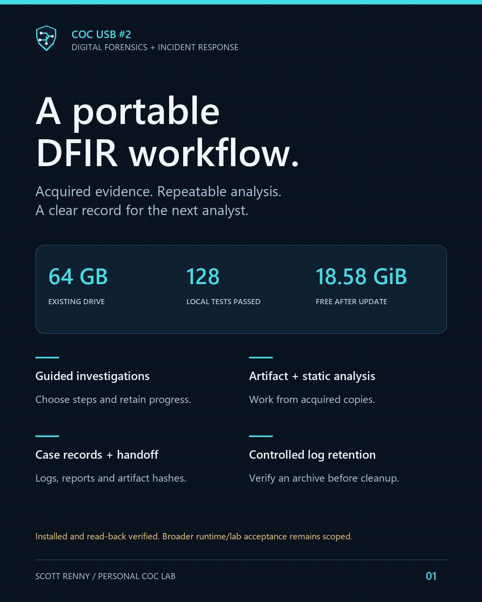

# COC USB #2 — DFIR and Incident Response

An existing 64 GB USB engineered into a guided digital forensics, incident-response and static malware-analysis toolkit for my personal Cyber Operations Center.

**Installed release:** 0.10.1 · **128 local Python tests passed** · **18.58 GiB free after the latest owner-run update**. The latest 35 changed files were copied and read-back verified. This is file-integrity/build evidence, not broad operational acceptance.

## Explore

- [Portfolio case study](https://scott-renny.github.io/projects/coc-usb2-dfir-toolkit.html)
- [Engineering journal](https://scott-renny.github.io/journal/building-a-dfir-workflow-on-a-usb.html)
- [Architecture and boundaries](docs/architecture.md)
- [Validation and outstanding acceptance](docs/validation.md)
- [Source edition and setup boundary](docs/source-edition.md)
- [Operations manager and generated-log safeguards](COC/docs/OPERATIONS-MANAGER.md)
- [Tool catalog](COC/manifests/tools.json) and [actual readiness records](COC/manifests/field-readiness.json)

## What I engineered

| Area | Custom workflow | Boundary |
|---|---|---|
| Incident guidance | Fixed offline routes for malware, phishing, servers, network captures and evidence intake; explicit step decisions and progress cases | Completed means parser/case completion, not incident resolution |
| Repeatable analysis | Acquired artifact, event, email, URL, cloud-log, APK, configuration, signature, similarity and container review workflows | Working copies; parser/version/input limits remain visible |
| Case records | Authority, case locks, source hashes, activity/errors, JSON/HTML reports, artifact manifests and verified handoff packets | Local hashes do not authenticate custody |
| Harmless practice | Three native parser workflows check known IP, byte content and user results | No host inventory, live queries or boot testing |
| Retention | Preview, selected generated logs, verified complete archive, typed confirmation, original-manifest lineage and cleanup receipts | Acquired system/evidence logs and unknown files are excluded; ZIP is not encrypted or secure erasure |
| Readiness | Offline version/rule-snapshot and acceptance dashboard | Unknown upstream currency remains unknown; no automatic downloads |
| Lab transport | Pinned Zeek/Suricata/Plaso images on the private USB; a restricted rootless-Podman runner | Separate prepared Linux lab required; runtime acceptance pending |

The installed toolkit also holds separately obtained third-party tools and lab appliances. This source edition does not redistribute those packages or claim authorship of them.

## Interface

The shared cyan console emblem and centered frame follow USB #1. The preview above is rendered from released menu text, not captured from a running device. The new operations menu is reached through Automated playbooks → 8; generated-log management is also under Logs and reports → 2.

## Validation status

128 Python tests passed in the staged toolkit environment, including 25 operations tests. Seven operations case workflows and the earlier five response workflows finalized with artifact verification. Three controlled guided-decision tests exercise real case/progress logic with the step-launch boundary mocked. Updater copy, backup, conflict refusal and read-back checks passed. The owner-run installation record confirms latest changed-file read-back and the measured free space.

Separate acceptance remains for real evidence, full live osquery collection, GUI dependencies and offline Zeek/Suricata/Plaso runtime/rule compilation. Earlier blocked/pending tools remain explicitly recorded. Boot testing was excluded at the owner's request. No universal forensic, production-readiness or professional-employment claim is made.

## Public source boundary

Custom Python/PowerShell/Java/shell source, selected synthetic fixtures, documentation, public graphics and a sanitized validation summary are shared. Device identifiers, identity-pinned installers, original transcripts, user evidence, vendor executables, ISOs, rule bundles, symbols and VM/container payloads are excluded. The source edition has no operative `release.json` and is **not a ready-to-run USB image or generic installer**. See setup boundaries before running anything.

Original project work follows the repository MIT license. Third-party names, packages and licenses retain their own rights. [USB #1](https://github.com/scott-renny/coc-usb-technician-toolkit) remains the separate repair/support toolkit.
