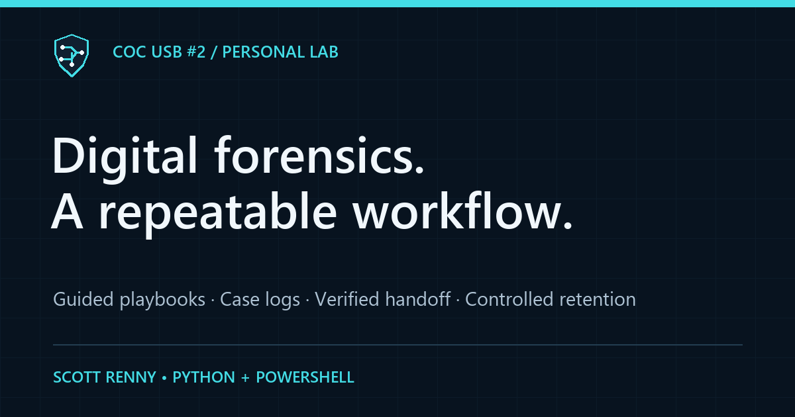
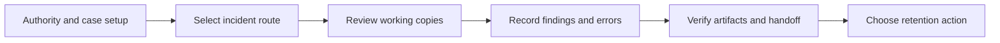
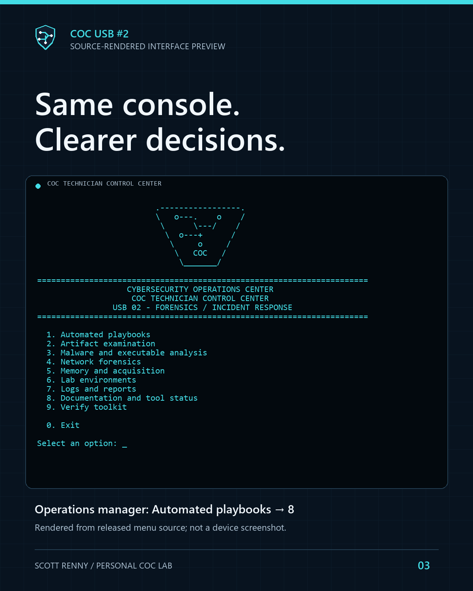

# COC USB #2
### Digital Forensics · Incident Response · Malware Analysis

A guided field toolkit for my personal Cyber Operations Center.

[Case study](https://scott-renny.github.io/projects/coc-usb2-dfir-toolkit.html) · [Engineering journal](https://scott-renny.github.io/journal/building-a-dfir-workflow-on-a-usb.html) · [Architecture](docs/architecture.md) · [Validation](docs/validation.md)

An existing **64 GB USB** engineered around repeatable investigation workflows, evidence records, offline analysis and explicit operator decisions. The custom engineering connects tools, cases and reports through a consistent centered console interface.

> **Source edition:** this repository shares original code, documentation and selected synthetic fixtures. It is not a ready-to-run USB image. Read the [setup boundaries](docs/source-edition.md) before running it.

**Recorded installation:** release 0.10.1 · 35 latest changed files copied and read-back verified · **18.58 GiB free at that update**. These are recorded build and file-integrity results; free space is not a live measurement. Test badges describe local staged results, not a hosted CI run.

[Explore](#explore) · [Custom workflows](#what-i-engineered) · [Investigation flow](#investigation-flow) · [Interface](#interface) · [Validation](#validation-status) · [Source boundary](#public-source-boundary)

---

## Explore

| Start here | What you will find |
|---|---|
| [Understand the design](docs/architecture.md) | Architecture, separation of responsibilities and operating boundaries |
| [Review the evidence](docs/validation.md) | Recorded checks, acceptance gaps and test scope |
| [Read the source setup guide](docs/source-edition.md) | What is included, what is omitted and supported source checks |
| [Follow an incident playbook](COC/docs/RESPONSE-PLAYBOOKS.md) | Guided routes and case/report workflows |
| [Manage cases and generated logs](COC/docs/OPERATIONS-MANAGER.md) | Retention previews, archive checks and cleanup safeguards |
| [Inspect tool readiness](COC/manifests/field-readiness.json) | Recorded tool status rather than an assumed all-ready inventory |

More project references

- [Portfolio case study](https://scott-renny.github.io/projects/coc-usb2-dfir-toolkit.html)
- [Engineering journal](https://scott-renny.github.io/journal/building-a-dfir-workflow-on-a-usb.html)
- [Architecture and boundaries](docs/architecture.md)
- [Validation and outstanding acceptance](docs/validation.md)
- [Source edition and setup boundary](docs/source-edition.md)
- [Operations manager and generated-log safeguards](COC/docs/OPERATIONS-MANAGER.md)
- [Tool catalog](COC/manifests/tools.json) and [actual readiness records](COC/manifests/field-readiness.json)

## What I engineered

| Area | Custom workflow | Boundary |
|---|---|---|
| Incident guidance | Fixed offline routes for malware, phishing, servers, network captures and evidence intake; explicit step decisions and progress cases | Completed means parser/case completion, not incident resolution |
| Repeatable analysis | Acquired artifact, event, email, URL, cloud-log, APK, configuration, signature, similarity and container review workflows | Working copies; parser/version/input limits remain visible |
| Case records | Authority, case locks, source hashes, activity/errors, JSON/HTML reports, artifact manifests and verified handoff packets | Local hashes do not authenticate custody |
| Harmless practice | Three native parser workflows check known IP, byte content and user results | No host inventory, live queries or boot testing |
| Retention | Preview, selected generated logs, verified complete archive, typed confirmation, original-manifest lineage and cleanup receipts | Acquired system/evidence logs and unknown files are excluded; ZIP is not encrypted or secure erasure |
| Readiness | Offline version/rule-snapshot and acceptance dashboard | Unknown upstream currency remains unknown; no automatic downloads |
| Lab transport | Pinned Zeek/Suricata/Plaso images on the private USB; a restricted rootless-Podman runner | Separate prepared Linux lab required; runtime acceptance pending |

The installed toolkit also holds separately obtained third-party tools and lab appliances. This source edition does not redistribute those packages or claim authorship of them.

## Investigation flow

Operator decisions remain explicit. A completed workflow records processing progress; it does not establish incident resolution or authenticate chain of custody.

## Interface

The shared cyan console emblem and centered frame follow USB #1. The preview above is rendered from released menu text, not captured from a running device. The new operations menu is reached through Automated playbooks → 8; generated-log management is also under Logs and reports → 2.

## Validation status

| Evidence layer | Recorded status |
|---|---|
| Local staged Python tests | **128 passed**, including 25 operations tests |
| Latest installed update | **35 changed files** copied and read-back verified |
| Controlled guided decisions | **3 flows checked** with the step-launch boundary mocked |
| Real evidence, live collection and lab runtime | **Separate acceptance pending** |
| Physical boot testing | **Excluded at the owner’s request** |

128 Python tests passed in the staged toolkit environment, including 25 operations tests. Seven operations case workflows and the earlier five response workflows finalized with artifact verification. Three controlled guided-decision tests exercise real case/progress logic with the step-launch boundary mocked. Updater copy, backup, conflict refusal and read-back checks passed. The owner-run installation record confirms latest changed-file read-back and the measured free space.

Separate acceptance remains for real evidence, full live osquery collection, GUI dependencies and offline Zeek/Suricata/Plaso runtime/rule compilation. Earlier blocked/pending tools remain explicitly recorded. Boot testing was excluded at the owner's request. No universal forensic, production-readiness or professional-employment claim is made.

## Public source boundary

Custom Python/PowerShell/Java/shell source, selected synthetic fixtures, documentation, public graphics and a sanitized validation summary are shared. Device identifiers, identity-pinned installers, original transcripts, user evidence, vendor executables, ISOs, rule bundles, symbols and VM/container payloads are excluded. The source edition has no operative `release.json` and is **not a ready-to-run USB image or generic installer**. See setup boundaries before running anything.

Original project work follows the repository MIT license. Third-party names, packages and licenses retain their own rights. [USB #1](https://github.com/scott-renny/coc-usb-technician-toolkit) remains the separate repair/support toolkit.

---

**Project references:** [Architecture](docs/architecture.md) · [Security guidance](SECURITY.md) · [Third-party attribution](THIRD_PARTY.md) · [MIT license](LICENSE)

**Related project:** [COC USB #1 — technician repair and support](https://github.com/scott-renny/coc-usb-technician-toolkit). USB #2 focuses on investigation, incident response and analysis.
