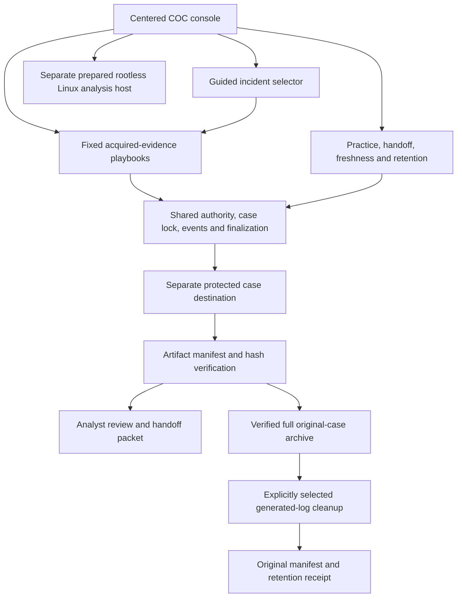

# Architecture and separation

The USB holds executable tools and documentation. Protected case storage is separate; protection is an owner attestation rather than automatic encryption verification. Acquired master evidence is preserved separately and analysis uses bounded working copies. Tool output is a lead for analyst review, not automatic attribution or clearance.

USB #1 remains Windows repair/support and migration. USB #2 is DFIR/incident response/static analysis. Central COC systems remain the monitoring and incident-management authority; no live COC credentials, endpoint enrollment, telemetry connector or central-system changes are shipped by this publication. No other USB role is silently reassigned.

Windows acquired-input profiles do not execute samples. The separately authorized live osquery workflow uses fixed queries without service/daemon installation; it changes host state and is not forensic acquisition. Offline lab transport uses immutable image/config pins and restricted rootless containers; this is not a malware detonation sandbox. The Suricata package on the private USB is from the jasonish community-maintainer image; Zeek and Plaso use project publisher images. Digests establish integrity, not publisher signature attestation.
